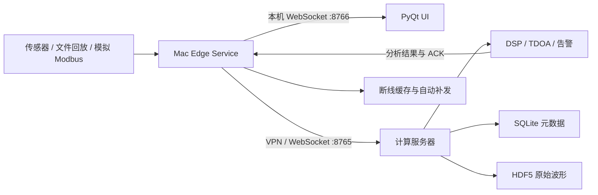

# SandAlert PC

SandAlert PC 是面向海上油气管道含砂监测场景开发的上位机与信号计算系统。项目采用前后端分离架构：Mac 负责边缘数据接入和 PyQt 操作界面，实验室服务器负责 DSP、含砂指标、报警和 TDOA 声源方向计算。

> 当前状态：第一阶段“Mac 边缘采集 + 服务器计算联调”已经完成。代码仍处于研究与工程验证阶段，不应直接作为未经验证的现场安全联锁系统使用。

## 系统架构



这套架构的职责边界如下：

- Mac Edge Service：组织采集数据、向本地 UI 广播原始波形、向服务器上传数据、网络中断时缓存并在恢复后补发。
- PyQt UI：只承担交互和显示，不执行第一阶段的服务器计算任务，因此网络波动不会阻塞界面线程。
- Compute Server：执行 DSP、含砂量指标、三级报警和四通道 TDOA 计算，并保存 SQLite/HDF5 数据。
- GitHub：唯一代码源。代码在 Mac 修改和测试后提交；服务器只拉取明确的分支或提交用于部署验证。

## 仓库结构

```text
SandAlert/
├── README.md                         # 仓库主页与操作入口
├── SandAlert_PC_Replica/             # 软件本体
│   ├── main.py                       # PyQt UI 入口
│   ├── edge/                         # Mac 边缘服务、缓存、重连和本地网关
│   ├── server/                       # FastAPI 计算与存储服务
│   ├── shared/                       # 通信协议、配置和波形编码
│   ├── core/                         # DSP、TDOA 与通信线程
│   ├── ui/                           # PyQt 界面
│   ├── config/                       # Edge/Server 配置样例
│   ├── requirements/                 # Mac、服务器和开发依赖
│   ├── tests/                        # 第一阶段自动化测试
│   ├── PHASE1_RUNBOOK.md             # 第一阶段简明运行手册
│   └── SandAlert_Technical_Document.md
└── Algorithm_Mock/                   # 算法 PoC、批量验证与历史结果
```

## 环境要求

### Mac 边缘端

- macOS，推荐 Apple Silicon
- Python 3.10 或更高版本
- 能通过 VPN/局域网访问计算服务器
- PyQt 界面和 Edge Service 在 Mac 本地运行

以下示例沿用开发环境名称 `playground`。也可以使用其他 Conda 环境，但不要混用系统 Python：

```bash
cd SandAlert_PC_Replica
conda activate playground
python -m pip install -r requirements/edge.txt
```

如果需要运行全部自动化测试，再安装开发依赖：

```bash
python -m pip install -r requirements/dev.txt
```

### lab 计算服务器

服务器端只能使用指定解释器：

```text
/home/lks/miniconda3/envs/core/bin/python
```

首次部署或依赖变化后执行：

```bash
cd /home/lks/project/SandAlert_PC/SandAlert_PC_Replica
/home/lks/miniconda3/envs/core/bin/python -m pip install -r requirements/server.txt
```

不要在服务器使用系统 `python`、`python3` 或其他 Conda 环境安装和运行 SandAlert。

## 第一次配置

配置样例可以提交到 Git；实际配置可能含地址和共享令牌，已被 `.gitignore` 排除，不能提交。

### 1. 配置服务器

在服务器执行：

```bash
cd /home/lks/project/SandAlert_PC/SandAlert_PC_Replica
cp config/server.example.toml config/server.toml
```

编辑 `config/server.toml`，至少确认：

```toml
[server]
host = "0.0.0.0"
port = 8765
token = "替换为双方一致的长随机令牌"
database_url = "sqlite:///./runtime/sandalert.sqlite3"
waveform_dir = "./runtime/waveforms"
```

端口 `8765` 只应通过可信 VPN 或受控网络开放。

### 2. 配置 Mac Edge Service

在 Mac 执行：

```bash
cd SandAlert_PC_Replica
cp config/edge.example.toml config/edge.toml
```

编辑 `config/edge.toml`：

```toml
[edge]
edge_id = "mac-edge-01"
server_url = "ws://服务器的VPN地址:8765/v1/ingest"
token = "与服务器完全一致的令牌"
local_host = "127.0.0.1"
local_port = 8766
spool_dir = "./runtime/edge-spool"
max_spool_gib = 20.0
source = "file_and_mock_modbus"
replay_path = "./runtime/sample_data"
```

第一阶段 Edge Service 支持以下输入：

| `source` | 行为 |
|---|---|
| `file` | 回放单通道或四通道 TXT/CSV 波形 |
| `mock_modbus` | 生成模拟 Modbus 指标 |
| `file_and_mock_modbus` | 同时回放波形和生成模拟 Modbus，推荐用于联调 |

旧版 UI 仍保留虚拟/真实串口、Modbus RTU/TCP 和本地文件回放入口。将真实硬件采集迁移进独立 Edge Service 是后续阶段工作。

## 标准启动流程

启动顺序应为：服务器 → Mac Edge Service → PyQt UI。

### 第一步：服务器启动计算服务

推荐在服务器使用 `tmux`：

```bash
ssh lab
cd /home/lks/project/SandAlert_PC/SandAlert_PC_Replica
tmux new -s sandalert-server
/home/lks/miniconda3/envs/core/bin/python -m server.main --config config/server.toml
```

看到以下信息说明服务启动成功：

```text
Application startup complete.
Uvicorn running on http://0.0.0.0:8765
```

按 `Ctrl+B`，再按 `D` 可以退出 tmux 界面而不停止服务。重新进入：

```bash
tmux attach -t sandalert-server
```

### 第二步：Mac 启动边缘服务

打开新的终端：

```bash
cd SandAlert_PC_Replica
conda activate playground
python -m edge.main --config config/edge.toml
```

Edge Service 会监听本机 `ws://127.0.0.1:8766`。服务器暂时不可用时，待发送内容会进入 `runtime/edge-spool`；连接恢复并收到服务器 ACK 后会自动清理。

### 第三步：Mac 启动 PyQt 界面

再打开一个终端：

```bash
cd SandAlert_PC_Replica
conda activate playground
python main.py
```

进入软件后：

1. 点击菜单栏 `Setup -> Comm Settings...`。
2. 选择默认的 `Edge Service Mode (Local Gateway)`。
3. 确认 `Edge Gateway` 为 `ws://127.0.0.1:8766`。
4. 点击 `Save & Connect`。
5. 在 `Signal Traces` 页面观察实时波形、IPS、Mass Rate、报警状态和 TDOA 方向。
6. 需要查看历史记录时，切换到 `DataLogging` 页面加载 CSV 报告或原始 TXT 文件夹。

在 Edge 模式下，原始波形由 Mac 本地网关直接送给 UI；IPS、Mass Rate、告警和 TDOA 等计算结果来自服务器。

## 无硬件联调

生成四通道 `60°` TDOA 样本：

```bash
cd SandAlert_PC_Replica
mkdir -p runtime/sample_data
python -m edge.generate_sample runtime/sample_data/tdoa_60deg.txt --angle 60
```

按“服务器 → Edge Service → UI”的顺序启动。也可以使用探针代替 UI 验证数据链路：

```bash
python -m edge.probe --seconds 10
```

正常输出应包含 `waveforms`、`analysis.result`、`modbus.result`、`tdoa.result` 和 `tdoa_angles`。60° 样本的当前联调结果约为 60.5°。

## 测试

Mac 开发环境：

```bash
cd SandAlert_PC_Replica
conda run -n playground python -m pytest -q
```

服务器必须使用 `core` 解释器：

```bash
cd /home/lks/project/SandAlert_PC/SandAlert_PC_Replica
/home/lks/miniconda3/envs/core/bin/python -m pytest -q
```

第一阶段基线为 6 项测试通过，覆盖波形编解码、采集、断线缓存、持久化和 WebSocket 服务。

## 数据与故障处理

- SQLite：记录会话、波形片段索引、Modbus、分析结果和告警元数据。
- HDF5：按会话保存原始波形，使用 LZF 压缩。
- Edge spool：服务器断开时保留未确认消息；默认容量上限为 20 GiB，达到上限会停止采集并明确报错，不会静默丢弃数据。
- UI 无数据：先确认 Edge Service 正在运行，再检查 UI 网关是否为 `ws://127.0.0.1:8766`。
- Edge 不回传结果：检查 `server_url`、双方 `token`、VPN 和服务器 `8765` 端口。
- 服务器进程退出：进入 tmux 查看错误，并确认所有命令都使用 `core` Python。

## Git 开发与服务器部署流程

本项目以 GitHub 为唯一代码源，推荐流程如下：

```text
Mac 创建 codex/功能分支
  → 本地修改与测试
  → 提交并推送 GitHub
  → 创建/更新 Pull Request
  → lab 服务器 fetch 并检出同一分支或提交
  → 使用 core Python 复测
```

服务器更新示例：

```bash
ssh lab
cd /home/lks/project/SandAlert_PC
git fetch origin
git switch codex/edge-server-phase1
git pull --ff-only origin codex/edge-server-phase1
```

不要直接在服务器修改源码。若服务器工作区出现未提交改动，应先检查来源，不要使用 `git reset --hard` 覆盖。

## 进一步阅读

- [第一阶段运行手册](SandAlert_PC_Replica/PHASE1_RUNBOOK.md)
- [SandAlert 技术白皮书](SandAlert_PC_Replica/SandAlert_Technical_Document.md)
- [阵列信号处理技术说明](Algorithm_Mock/SandAlert_Array_PoC/Array_Signal_Processing_Tech_Spec.md)

## 当前阶段边界

第一阶段已经打通 Mac 文件/模拟数据源、可靠上行、服务器计算、结果回传和本地 UI 展示。下一阶段建议优先完成：

1. 将真实串口和真实 Modbus 采集适配器迁入独立 Edge Service。
2. 增加 TLS 或反向代理、令牌轮换和设备身份管理。
3. 增加服务器进程守护、日志轮转、健康监控和备份策略。
4. 扩展真实现场数据回放、性能压测和长时间稳定性测试。
