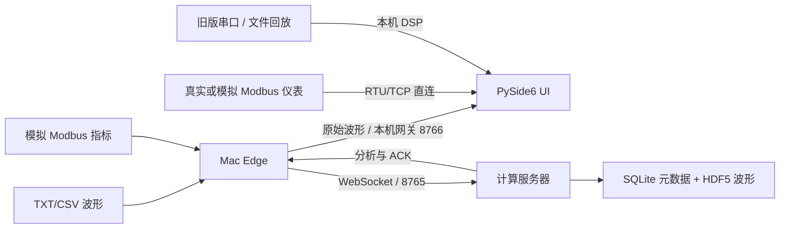

# SandAlert PC 技术说明

更新：2026-10-19。本文描述 `codex/stage1-bugfixes` 的当前行为。
旧版完整草稿保存在 [v5 历史存档](docs/archive/SandAlert_Technical_Document_v5_legacy.md)，其中旧公式与接口不能直接用于当前代码。

## 1. 目标与完成范围

系统把声学波形/仪表指标接入、DSP 与 TDOA 分析、界面显示和存储连起来。
目前支持软件模拟及文件回放验证；IPS 是算法检测到的峰速率，质量输出依赖实测标定系数。
模拟测试不证明现场砂粒数、实际质量流率或报警精度。

## 2. 两条运行路径



- 默认 `Edge Service Mode`：UI 绘制原始波形，服务器计算、归档并回传结果。
- `Mock String` / `File Replay`：旧版本机波形路径。本机采样率在 Parameters → System 设置，默认 1000 Hz；串口发送节奏不代表信号的真实采样率。四通道阵列模拟数据使用 2 MHz 时，应填写 `2000000`。
- `Modbus RTU/TCP`：直接使用仪表指标和继电器状态，不对指标再执行波形 DSP。
- Edge 的 `MockModbusSource` 与独立 `mock_modbus_server.py` 是两个不同的数据源。

## 3. 波形 DSP 与量纲

`core/dsp_engine.py` 使用四阶 20 Hz 高通的 SOS 零相位滤波，再整流、估计平均背景、寻峰。
原始电压可以有直流偏置，滤波前不截断；整流后峰值不小于 2 V 的候选被剔除。
默认峰间距仍是 10 个采样点，这属于当前检测器定义，尚不能等同于逐粒砂粒计数。

设窗口有 N 个样点，采样率为 fs，持续时间 T=N/fs；P 为有效峰集合，b 为整流信号的平均背景：

```text
E = sum((peak - b)^2)                 峰值能量代理量，单位 V²
IPS = round(len(P) / T)               每秒峰数，协议 v1 使用整数
window_mass = E / K                   g，K 的单位为 V²/g
mass_rate = E / K / T                 g/s
cumulative_mass += mass_rate * dt     dt 为本次新增数据点数 / fs
```

E 是算法代理量，不是以焦耳计的声学能量。K 必须来自已知投砂质量及对应采集条件的标定。
参数 0.008 V、K=1.2、报警 0.05/0.10 g/s 是软件默认值，并非本阶段现场验收结果。

服务器以波形元数据 `fs_hz` 为准；旧 `dsp_sample_rate` 配置仅保留兼容字段。
20 Hz 截止在 1 kHz 和 2 MHz 下保持同一物理频率，SOS 避免高采样率下多项式滤波器数值不稳。
当前滚动窗口为 3000 点，窗口速率是平滑估计；流结束时仍在窗口中的事件不会被额外“补算”成离散事件总量。
服务器将大帧拆成最多 500 点的连续子帧，避免只处理最后 3000 点；大帧回传的速率是子帧速率的时间加权平均，`window_energy` 是末次分析窗口的 E。
采样率或通道数改变时清空分析上下文并保留已累计质量，避免跨格式拼窗。

本机波形路径在 CSV 中按 `shift/fs` 积分；标定时按 `E*shift/N` 累积能量代理量。
二者满足 `recorded_mass = accumulated_energy / K`，不会把每次重叠窗口的完整 E 反复累加。

**迁移要求：** 旧实现把窗口峰数/质量直接标为每秒速率，旧标定也重复累加完整窗口。历史系数不能自动沿用到新语义，应重新标定；此前已存档 CSV 不重写。

## 4. 标定与参数生效范围

本机波形模式允许开始/结束投砂标定，K=累积能量代理量/已知投砂质量。
投砂质量必须为正且有限；标定期间锁定采样率，保留足够精度写回 K。

Edge 模式禁用本机标定及本地阈值、系数、报警阈值编辑，提示服务器配置负责这些参数。
本阶段未增加远程参数写入协议。Modbus 模式使用仪表自己的标定及报警，不对仪表指标进行上位机波形标定。
切换数据源会结束并清空未完成的标定。

## 5. TDOA

四探头圆阵默认半径 0.05 m，方位 0/90/180/270°，模型声速 1500 m/s。
算法为 GCC-PHAT 时延估计、物理时差约束、多候选峰、亚采样插值与角度网格搜索。
服务器等峰进入窗口中部再提取 2000 点片段，检查 Cost 与相关峰置信度后回传可靠性。
100–300 kHz 限带默认关闭，启用需先确认现场频谱。

协议 v1 同时保留 `analysis.result` 中的 TDOA 字段和 `tdoa.result` 事件。
UI 以 `(session_id, sequence)` 去重，缓存有上限；相同角度但不同序号的真实事件仍分别记录。
关闭 TDOA 显示时清图并忽略结果，重新连接本机网关时重建显示上下文。

## 6. 双数据源 UI

Edge 模式的“指标来源”支持自动、波形分析、Modbus 仪表：

- 自动模式在没有波形分析结果时显示 Modbus；收到波形结果后固定优先波形，后续 Modbus 不再覆盖同一组指标/报警。
- 显式选择某来源只显示该来源的最近一组一致结果；尚无结果时显示 WAITING。
- TDOA 仍来自波形分析，独立于指标来源选择。
- 波形图横轴为采样点索引，不再把索引标成秒。

## 7. 可靠上传、归档与报表

Edge 待发送消息保存在磁盘 spool，收到 ACK 才清理；默认容量上限 20 GiB。
接收端按会话、序号和类型去重。上行连接任一收发任务结束后都清理另一任务并重连。
退出时等磁盘操作及收发任务结束再关闭 SQLite，防止后台任务访问已关闭数据库。

服务器 SQLite 存会话、波形索引、分析及告警，HDF5 按会话存波形。
`/health` 可检查服务，`/v1/sessions/{session_id}/export.csv` 使用令牌导出该会话。
本阶段不改变数据库表结构；内存滚动窗口/累计处理状态不提供跨服务器重启的完整恢复。

本机 Modbus 的 11 寄存器映射、累计量基线/复位规则见 [本地 Modbus 手册](LOCAL_MODBUS_RUNBOOK.md)。
DataLogging 的 CSV 入口展示报表数值；旧 TXT 文件夹入口仍使用示意性的阈值计数与绝对积分，不复用在线 DSP，不能作为同一算法的定量重算。

## 8. 运行与验证入口

- [README](../README.md)：环境、启动顺序、新设备拉取。
- [阶段修复和迁移说明](STAGE1_BUGFIXES.md)：验证命令及修复边界。
- [taskline.md](../taskline.md)：当前进度与下一步。
- `scripts/smoke_pipeline.py`：在临时目录启动本地 Server/Edge、生成 60° 波形、检查 ACK 清缓存、TDOA、砂率积分及 CSV；也可通过 SSH 隧道验证独立远程测试服务。
- `scripts/evaluate_tdoa.py`：可复现的模拟 TDOA 方法对照。算法精度结果属于对应模拟条件。
